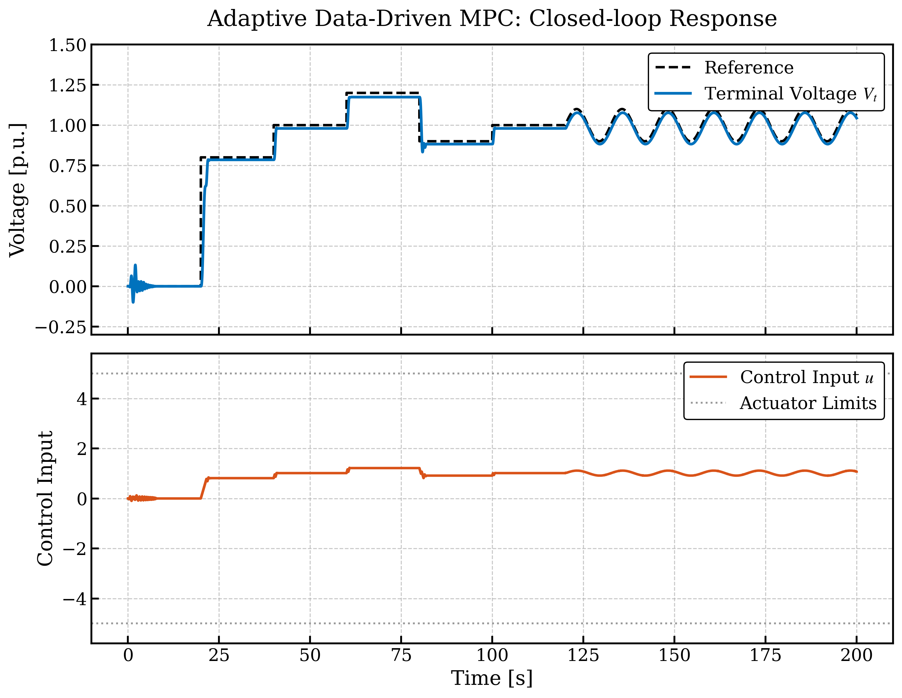

# Adaptive-Data-Driven-Model-Predictive-Control
Adaptive Data-Driven Model Predictive Control (MPC) for AVR Systems


## 📌 Overview
This repository contains the Python implementation of an **Adaptive Data-Driven Model Predictive Control (MPC)** strategy for an Automatic Voltage Regulator (AVR) system. 

Unlike traditional MPC approaches that rely on a fixed nominal model, this framework utilizes **Recursive Least Squares (RLS)** to identify the system's ARMAX model online. The identified model is then used by the MPC to compute optimal control actions via the **OSQP** solver, ensuring robust performance under parameter variations and dynamic tracking scenarios.

## 📊 Simulation Results
The figure below demonstrates the closed-loop performance of the proposed controller. The system is tested against a hybrid reference trajectory: a piecewise constant step sequence (to evaluate settling time) followed by a sinusoidal reference (to test dynamic tracking).



*Figure 1: Top: Terminal voltage perfectly tracking the reference. Bottom: Control input (exciter voltage) strictly respecting the actuator limits [-5, 5] p.u.*

## ✨ Key Features
- **Online System Identification:** RLS with forgetting factor for real-time parameter estimation.
- **Constraint Handling:** Strict enforcement of amplitude and rate constraints on the control input.
- **Publication-Ready Plots:** Automatically generates high-resolution (300 DPI) and vector (PDF) plots.


## Citation

If you use this code or build upon it, please cite the following article in which this method appears as a comparative baseline:

```bibtex
@article{karimzadeh2026robust,
  title={Robust data-driven control of Automatic Voltage Regulators using DeePC: Regularization techniques under noise and uncertainty},
  author={Karimzadeh, Abdollah and Mousavi, Seyed Aref and Asemani, Mohammad Hassan},
  journal={International Journal of Electrical Power \& Energy Systems},
  volume={178},
  pages={111973},
  year={2026},
  publisher={Elsevier}
}
```

## 📁 Repository Structure
```text
adaptive-mpc-avr/
│
├── src/
│   ├── avr_system.py      # AVR plant modeling and discretization
│   ├── rls.py             # RLS parameter estimator
│   └── mpc.py             # Adaptive MPC controller
│
├── results/               # Generated figures
├── main.py                # Main execution script
├── requirements.txt       # Python dependencies
└── README.md              # Project documentation
